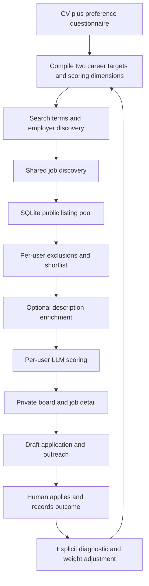

# Career-source expansion — 22 September 2026

Added a persistent source registry with a paginated search panel, 1,000-source
batch action, six network workers, source leases, failure/backoff states and
provenance. Imported 22,691 structurally valid board candidates from four public
ATS catalogs, plus curated banks and government pages. Import is not verification.
The first 1,000-source sweep returned listings from 659 sources, with 1,175
role-relevant records worldwide. Subsequent Goldman collection returned another
100 listings through its public API; Standard Chartered returned 10 from its
public search endpoint. At this checkpoint 661 registered sources returned
listings. These are coverage counts, not suitable or salary-verified job counts.
The complete regression suite passed: 471 tests. The source panel passed desktop
and 390px mobile rendering and company-filter checks.

Bank role selection now includes adjacent operational grades without equating a
bank's title with another employer's seniority. Salary, sales exclusions and
location preferences still gate the personal dashboard. The Sources panel explains
plausible role families, geographical prospects and specialist knowledge gaps.
CRISIL and unsupported dynamic pages are labelled manual; blocks and failures stay
visible. Government homepages are not represented as matching vacancies. Bounded
pagination means partial coverage is explicitly recorded, not full-site coverage.

---

# Personal workspace update — 21 September 2026

Active product now uses one private Shivani database and no login. Prior shared data
is preserved. Local host/client and cross-origin write checks guard the active app.
The CLI defaults to the dashboard; multi-user provisioning and public publishing
commands are removed from its active command map.

Added salary/location/sales/travel evidence checks, private candidate brief,
editable location/pay preferences, structured uncertainty, profile revision tracking,
application outcome events, public description enrichment, rotating free search
coverage, and visible scan failure state. Model scoring now respects balanced
career goals instead of automatically rewarding stretches. Existing model credentials
remain usable; no provider migration is claimed.

A live search discovered 818 listings and scored 24 shortlisted leads. These are
conditional leads, not verified compensation matches. Many aggregation results
initially lacked descriptions; enrichment and explicit uncertainty address that gap.
No applications or external messages were sent. The regression suite now contains 464 tests. Desktop and 390px mobile browser
checks passed. Dependency consistency passes after repairing the SciPy/NumPy
version mismatch. Twelve empty root scratch files were removed. After fuller
description analysis and reapplying dealbreakers, 16 conditional leads remain
visible; all 16 now have substantive descriptions. Salary remains unverified.

Remaining limitations: third-party source coverage and deadlines can change;
unpublished salary and culture cannot be verified automatically. Some legacy modules
are retained for compatibility. The scheduler lock is process-local: run only one
app/scanner process. This is not a public SaaS security certification or a promise
that every possible bug has been eliminated. Original audit below is historical;
its multi-user and untouched-database statements describe the earlier audit pass.

---

# Career Loop — engineering audit

Audit date: 20 September 2026. Starting revision: `f96e387`.

## Assessment

Career Loop is a functioning local job-intelligence product, with substantial
test coverage and a sensible architecture for three trusted users. It is not
ready to be treated as an unattended, publicly hosted service. The main risks
are workflow correctness, incomplete source data, and promises that the code
does not yet enforce. A framework rewrite would not address those risks.

This audit inspected the application modules, CLI, configuration, schema,
templates, source adapters, and test/CI setup; ran the existing suite; added
cross-component regression cases; and made targeted repairs. It did not call
paid services, send notifications, deploy anything, or change the live database.
Provider schemas, current prices, live LLM quality, and Internet-facing security
have not been certified by this audit.

## Product scope and architecture

The product helps people choose jobs and prepare applications. It does not
submit applications. The intended loop is:

| Area | Implementation | Actual scope |
|---|---|---|
| Entry points | `run.py` | Local portal, user seeding, legacy CLI, diagnostics, publishing, migration, model warm-up |
| Web | `web/app.py`, `web/jobs.py`, `web/intake_routes.py` | FastAPI with server-rendered Jinja templates and handwritten CSS; no SPA/build toolchain |
| Identity | `core/session.py` | Scrypt passwords, HMAC session cookies, 14-day sessions, default-deny route middleware |
| Persistence | `core/db.py`, `core/schema.py` | SQLite WAL; append-only migrations; connections per operation/thread |
| Shared data | `jobs`, `companies`, `job_boards`, `settings` | Public listings, review cache, ATS discovery, search cursors |
| Private data | `profiles`, `user_jobs`, `applications`, `runs` | CV/targets, scores/status, drafts/outcomes, scan records scoped by user |
| Intake | `core/intake.py`, `core/resume.py`, `core/formgen.py` | PDF/DOCX/RTF/text CVs; generated Google Form assets; CSV import; adaptive CLI questionnaire |
| Matching | `core/dimensions.py`, `core/prefilter.py`, `core/semantic.py`, `core/score.py` | Three universal dimensions plus generated dimensions; experience weight capped at 9%; optional static embeddings; batched OpenAI scoring |
| Discovery | `core/discover.py`, `core/sources_free.py`, `core/sources_apify.py`, `core/firecrawl.py`, `core/companies.py` | Six ATS adapters, Instahyre, JobSpy, Apify Naukri/LinkedIn, Firecrawl, employer slug probing |
| Scheduling | `core/scheduler.py` | Boot catch-up against 07:00/18:00 IST slots, 3-hour automatic cooldown, manual override, in-process scan lock |
| Output | `core/tailor.py`, `core/notify.py`, `core/publish.py`, `web/export.py` | Draft text/contact research, Telegram summary, standalone HTML, XLSX/CSV |
| Feedback | `core/feedback.py` | Reads portal outcomes; diagnosis/reweighting requires explicit CLI invocation |

The two targets are **ideal** (career direction) and **leverage** (work the CV
already supports). They share scoring dimensions, with a track label; this is
not two independent ranking systems. The board caps new jobs at 15 above a
4.0 floor and retains curated pipeline stages. The jobs view caps at 250; export
is uncapped. Scans shortlist up to 40 candidates per user. Scoring runs one
batch first for prompt caching, followed by up to four concurrent batches.

The portal and the original single-user JSON CLI remain separate execution
paths. `run.py scan`, `calibrate`, and `log` do not operate on a named portal
account. This distinction is essential when operating or extending the project.

### Configuration actually shipped

- Direct ATS, Instahyre, and JobSpy are enabled.
- Apify Naukri is enabled when credentials exist; its configured spending
  estimate ceiling is $1.50 per scan. Prices are configuration values, not
  independently verified current billing rates.
- Paid LinkedIn is disabled. Firecrawl is nominally enabled, but open-web
  search is disabled and its career-page list is empty.
- Naukri full details are disabled. Reviews are fetched on demand by default.
- Semantic-model download is intended to be an explicit `warm-up` action.

### Data observed, read-only

The default database passed `PRAGMA quick_check`. It contains 3 users,
3 profiles, 963 jobs, 76 user-job score rows, and no applications, run records,
or discovered boards. Its schema version is 10, behind the original checkout's
12 migrations and this audit's new version 13.

887 listings have no score for any user. That is not proof that all 887 are
missing opportunities: prefilter exclusions also produce unscored listings.
The lack of run history means this database alone cannot establish successful
end-to-end live operation or historical source reliability.

## Defects repaired

Regression coverage is in `tests/test_audit.py`. The initial 11 regression
cases all failed before the first fixes and passed afterward.

| Priority | Defect and practical impact | Repair |
|---|---|---|
| P1 | Shared dedup marked listings known before scoring succeeded. Dry runs, failed batches, shortlist overflow, and later onboarding could permanently strand listings. | Scoring now considers the open shared pool and excludes jobs already scored for each user. Discovery identity is independent of scoring completion. |
| P1 | Already-scored jobs occupied the shortlist before being removed, starving unscored jobs below the cap. | Remove each user's completed jobs before shortlisting. |
| P1 | LinkedIn could exhaust the shared paid-source budget; remaining `0` was interpreted as unlimited by the Naukri helper. | Explicitly skip Naukri when the remaining allowance is exhausted. |
| P1 | Migration scripts committed DDL separately from version records. A failed migration could leave columns/tables that made every retry fail. Concurrent initializers could race. | Acquire `BEGIN IMMEDIATE`, re-read version under the lock, execute statements and version records transactionally, roll back on failure, close failed connections. |
| P1 | Review-cache writes committed partial boards inside the scoring transaction; the error handler could then retain incomplete results. | Commit the complete board before independent review caching; roll back failed writes before recording failure. |
| P2 | A second title/company dedup pass discarded same-title jobs in different cities. | The portal's second pass deduplicates canonical URLs only; discovery retains responsibility for cross-source duplicate heuristics. |
| P2 | Firecrawl created per-role fragments, but database URL normalization removed them, collapsing multiple roles into one row. | Reserve and preserve `careerloop-job=` fragments. Ordinary tracking/navigation fragments still normalize away. |
| P2 | Link checks repeatedly selected the oldest live links, never draining a bounded queue. | Persist `link_checked_at`, including unsuccessful attempts, and check least-recently-attempted links first. |
| P2 | Search-term generation and the keyword fallback omitted the leverage target, despite semantic matching accepting it. | Include both targets; interleave search terms so the cap does not erase the second target. |
| P2 | Semantic ranking loaded an uncached model directly, bypassing the availability check. | Check availability before loading during ranking. |
| P2 | Intake inferred a CV-based target without passing the saved CV, retained old search terms after target changes, and ran blocking model/parsing work on the event loop. | Supply bounded CV text; retain calibration only for unchanged targets; use synchronous worker-pool routes; bound CSV reads and handle CSV parse errors. |
| P2 | Export ignored the selected career track even though its link carried that filter. | Apply the same ideal/leverage/both filtering as the jobs view. |

Supporting changes persist Firecrawl enrichment state across failed scoring
attempts, stamp newly inserted listings as seen, declare the missing `httpx`
TestClient dependency, and clarify Python 3.11 setup on Windows.

## Remaining findings — not fixed in this pass

Priorities describe engineering impact; they are not a claim of exploitability
in the default loopback-only deployment.

### P1: Public export is not a privacy boundary

`core/publish.py:_job_html` emits `angle` and `risk`, which are generated using
the person's profile/CV. A synthetic reproduction confirmed that an email in
an angle and a private salary in a risk both appear in the published document.
Omitting `resume_text` and selected profile fields does not sanitize free text.
The module also claims a strict CSP that `render()` does not emit.

Define a public export schema containing only public listing facts and explicit
user-approved content. Treat existing generated pages as personal artifacts,
not automatically anonymous documents. No pages were published by this audit.

### P1: Stated hard constraints are not all enforced

`core/prefilter.py` never reads `min_ctc_lpa`, and source adapters do not persist
a normalized compensation range. A listing explicitly advertising 10 LPA
survives a 25 LPA floor. `_location_ok` treats any allowed value containing
`remote` as permission for every location, including an overseas onsite role.

Define salary units/ranges, unknown-salary behavior, remote eligibility and
geographic restrictions, then validate them as data. Do not drop undisclosed
salary listings by accident or infer remote eligibility from location alone.

### P1: Scoring often lacks the evidence its explanations imply

`config/sources.yml` disables Naukri `fetch_details` and says details will be
bought after shortlisting, but no Naukri enrichment stage exists. SmartRecruiters
and Workday adapters return empty descriptions. Greenhouse keeps HTML, Lever
uses only `descriptionPlain`, and `score.py` sends only the first 1,500
description characters. Requirements and salary often occur later or in fields
that were discarded. Company scoring happens before optional review enrichment.

Add bounded, source-specific detail fetching, HTML/text normalization, evidence
coverage metadata, and visible uncertainty for incomplete listings before
treating generated fit/risk statements as dependable.

### P2: External data and LLM outputs need structural validation

`intake.finalize_profile` normalizes top-level fields but accepts malformed
nested fields and does not validate all second-target fields. A synthetic
`exclude_keywords: null` profile passed finalization and crashed prefiltering.
`score.collect` accepts wrong-typed text fields and an unhashable result URL
can abort collection. Tailored bullet replacements are instructed to quote
the CV but are not verified against it. Review sector medians are estimated
by the model, not fetched with provenance. Duplicate company names differing
only by case can also multiply rows in case-insensitive joins.

Introduce typed boundary schemas and provenance checks. Preserve useful partial
results, but distinguish invalid output from a real negative match. Bound DOCX
expanded sizes and handle malformed XML as a user-facing upload error; the
current compressed-file size limit alone does not do this.

### P2: Source coverage and spending still need a unified policy

JobSpy takes the first configured term/location combinations each time;
Firecrawl search takes the first terms and one location. Those tails can starve.
LinkedIn treats *any* seeded term as meaning all future keywords need only a
daily delta. SmartRecruiters and Workday stop at one capped page. Discovery
returns already-collapsed rows, so `mark_seen` cannot actually stamp every raw
duplicate URL as its comment promises.

Firecrawl's `max_enrich_per_scan` is applied separately per user; the same page
can be fetched again for another user. The repaired Apify exhaustion case does
not establish a universal cap covering LLMs, Firecrawl, reviews and concurrent
processes. Persist a per-provider cursor, per-keyword seed state, shared
enrichment cache, and scan-level spend ledger. Verify costs against provider
billing before advertising any estimate as a hard monetary guarantee.

### P2: Scheduling and failure visibility are incomplete

The scanner's lock is local to one instance/process. Multiple servers or the
legacy CLI can run concurrently. The worker is a daemon with no shutdown join;
interruption can leave `running` records. `_score_for_user` catches failures
without setting global scan error state, and the UI does not show per-user run
history. A successful user run can start the cooldown despite another user's
failure. Source failures often look like zero results.

Add durable scan ownership, explicit partial-success state, recovery of abandoned
runs, source outcomes, and a private run-history view. The two daily slots are
boot-time targets; a continuously running server does not automatically scan
when those times arrive.

### P2: Profile and outcome lifecycle is incomplete

Changed profiles/weights do not invalidate existing job scores, so old opinions
remain next to new scoring dimensions. A deliberate, bounded rescore command is
needed. Portal status changes update `user_jobs` but do not record an application
timestamp/event; `/applications` only lists rows already in `applications`.
Old explicitly stored outcomes can override newer board statuses in diagnostics.
Feedback sees URLs/status counts without the scored feature vectors, limiting
how defensible its weight adjustments can be.

Keep an outcome event history and profile/score revision IDs. The legacy JSON
pipeline still has its own title/company dedup, fixed threshold, seen-state
and global calibration cache. Port it onto the portal services or clearly
deprecate it; the retry repair in this audit applies to the SQLite portal path.

### P2: Authentication and network controls assume trusted local use

There is no login throttling, explicit CSRF/origin validation, host allowlist,
session revocation, or secure-cookie setting for HTTPS deployment. `SameSite=Lax`
does mitigate ordinary cross-site authenticated POSTs, and routes are gated;
this is not a claim that authentication is absent. `is_admin` is not enforced as
an authorization policy.

`get_secret` can return a fresh, unpersisted key when another creator's file is
still empty. An empty key file reproduced the symptom: a freshly issued session
could not be read back. Atomic key publication/recovery needs a fix. The link
checker follows scraped URLs/redirects without blocking private network targets;
it needs an outbound URL policy before accepting less-trusted discovery inputs.

### P3: Reproducibility, maintainability and documentation

Dependencies have lower bounds only; optional packages and test tools are mixed
with runtime dependencies. Installed `pip check` fails: SciPy 1.17.1 requires
NumPy >=1.26.4,<2.7, while this environment has NumPy 1.26.3. This audit did not
modify the shared Python installation. Build a project virtual environment and
lock a tested dependency set.

The default Ruff invocation inherits configuration from outside this repository
and reported 70 findings at baseline. There is no repository-owned lint policy.
Most are style/exception-handling findings; they are distinct from confirmed
runtime bugs. Long modules and extensive historical commentary obscure the
current contracts. Twelve tracked zero-byte scratch files at the repository
root were left untouched. README test counts, provider assertions, privacy
claims and configuration comments have drifted; the historical benchmark and
pricing claims were not re-measured or revalidated here.

## Validation and operating implications

- Baseline: **444 passed**, including Playwright/Chromium tests; three dependency
  deprecation warnings.
- Post-change full suite: **459 passed in 143.21 seconds**, including 15 added
  regression cases and the Chromium tests; the same three dependency warnings.
- Targeted static checks: passed with repository-independent Ruff selection
  `E9,F63,F7,F82,F401,F841`. `git diff --check` passed.
- Live database: read-only quick check passed.
- Migration on a temporary SQLite backup of the live database: schema 10 → 13,
  integrity check passed, zero foreign-key violations, all four relevant table
  counts preserved (3 users, 3 profiles, 963 jobs, 76 user-job rows).
- Migration failure injection proves rollback and retry. Board-write failure
  injection covers rating-cache commits as well as invalid score data.
- Paid integrations and notification delivery were mocked. Existing browser
  tests may fetch public fonts; this was not a fully network-isolated suite.

Run checks with `py -3.11 -m pytest -q` on this Windows machine. Use
`py -3.11 run.py serve --no-scan --dry` for a portal preview that makes no paid
calls; it still opens/migrates its selected database. `--dry` is not a read-only
mode: a dry scan can store discovered listings and run free network checks.

The next normal database connection will apply migrations 11–13 to the live
schema-10 database. Take a SQLite backup before upgrading. The next paid scan
can now consider older unscored listings, within the existing per-user shortlist
cap, so its candidate mix can differ from the former fresh-only behavior.
No live rescore or paid scan was run during this audit.

Recommended order: fix public-export privacy and evidence/constraint integrity;
then structured model validation and private failure reporting; then unify scan
ownership, spend accounting, and profile/outcome revisioning. Preserve the
current FastAPI/SQLite architecture while addressing these specific contracts.

## September 23: budget, scoring and UI verification

- Naukri uses a durable SQLite reservation ledger, Apify account-cycle usage,
  price checks, a $0.25 API charge ceiling and a $0.50 monthly buffer.
  Actor starts never retry automatically after an ambiguous response.
- Full descriptions, salary/experience evidence and included AmbitionBox ratings
  now survive mapping. Paid review lookups cannot bypass the personal allowance.
- Live pilot: empty narrow query $0.001, broader query 50 detailed jobs $0.151.
  Four passed the initial free profile filter. Account usage approximately $0.821.
- Personal scoring defaults to local evidence scoring, compact JSON and short identifiers;
  ordinary scans score at most 12 jobs. Unknown salary/work-life evidence no
  longer becomes arbitrary low fit. Evidence coverage is separate; mandatory
  qualification gaps cap fit at 5. Existing eligible leads were rerated.
- Free discovery skips paid sources and all AI scoring. Drafts reuse saved text
  unless explicitly regenerated. Token accounting stores counts, never prompts.
- Fixed null-company dashboard search and missing template context during a
  process/template version mismatch. Restarted the server with the current code.
  A template nesting regression introduced during edits was caught and fixed.
- All 48 live navigation/detail URLs passed Chromium checks. Desktop and phone
  layouts had no horizontal overflow or JavaScript errors. Navigation now exposes
  applications and ignored jobs.
- Full suite: 490 passed, three dependency deprecation warnings. Two additional
  zero-spend/draft-cache regressions passed afterward with the personal tests.
  New budget and scoring modules passed Ruff.

Limits: employer sites can still deny scraping; candidate career pages are not
verified vacancies. No claims of perfect matching or a permanently bug-free
system. Salary, shift and eligibility questions remain visible. Codex's selected
model is separate from the app scorer; this turn did not change the Codex model.

The live free-only engine scan completed: 145 new listings stored, zero AI calls
and no paid actor starts. Last refinements disable bulk LinkedIn detail fetches,
preserve requirement text at the end of long descriptions, normalize remote
searches, and persist discovery status. Focused scoring/learning checks (31) and
personal/scheduler checks (23) passed. The final restart command was rejected by
automatic approval review without a specific reason; these last Python changes
need an app restart. The running server retains the earlier verified fixes.
